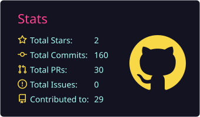
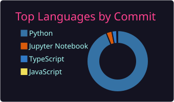
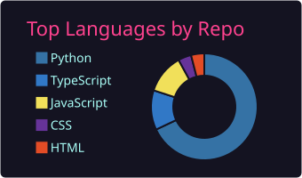
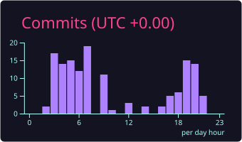

<!-- ============================ HEADER ============================ -->

 

  

<!-- ============================= ABOUT ============================= -->
##  Hi, I'm Atul 

I build machine learning systems that go **beyond the notebook**: raw data in, deployed and tracked pipelines out.

From decoding deep-sea DNA with **PyTorch**, to orchestrating **multi-agent LLM systems**, to simulating **autonomous drone swarms**, I care about one thing: **impact you can measure.**

| | |
|---|---|
| 🔭 **Building now** | A production-grade churn-prediction system (MLflow, FastAPI, Docker, CI/CD) |
| 🌱 **Learning** | Generative AI, agentic workflows, AWS, Kubernetes |
| 🧠 **Sharpening** | DSA and problem solving |
| 💬 **Ask me about** | ML pipelines, LLM agents, MCP, cloud basics, hackathons |
| 🎯 **Looking for** | Data Science / Machine Learning internships |

<b>⚡ A little more about me (click to expand)</b>

 

- 🌌 Anime aesthetics, late-night coding, and futuristic tech
- 🚀 Dreaming big and building consistently every single day
- 🎯 Goals: become an industry-ready ML Engineer, build impactful AI applications, and contribute to open source

<!-- =========================== TECH STACK ========================== -->
##  Tech Stack

**Languages** 

**AI / ML / Data** 

**Backend & Full-Stack** 

**MLOps, Cloud & DevOps** 

<!-- ============================ PROJECTS =========================== -->
##  Featured Projects

| Project | What it does | Built with |
|---|---|---|
| 🏢 **[VEDA_123](https://github.com/jackstealer/VEDA_123)** | Enterprise-grade multi-agent platform for **M&A due diligence on Indian startups**. Six parallel AI agents cover code audit, regulatory compliance, market forecasting, competitor intel and news sentiment. | `Python` `Multi-Agent AI` `LLMs` |
| 🛸 **[Jatayuu](https://github.com/jackstealer/Jatayuu)** | Real-time **autonomous drone swarm** simulation and command platform: 8 AI-driven drones, P2P mesh networking, CRDT state, leader election, task auctions, and a live React dashboard. | `Python` `React` `Distributed Systems` |
| ❤️ **[heart-disease-analysis](https://github.com/jackstealer/heart-disease-analysis)** | AI-powered **cardiovascular risk assessment**. An ensemble of 6 ML models on 4,500+ CDC BRFSS records, with LLM-generated health insights and a 3D heart visualization. | `XGBoost` `LightGBM` `CatBoost` `LLM` |
| 🧬 **[DeepSea-eDNA-AI](https://github.com/jackstealer/DeepSea-eDNA-AI)** | Marine biodiversity pipeline that **reduces reliance on incomplete reference databases** and cuts computation time on large eDNA datasets. | `Python` `PyTorch` `Bioinformatics` |
| 🌦️ **[weather-forecasting-ml](https://github.com/jackstealer/weather-forecasting-ml)** | ML weather forecasting with **87%+ accuracy** using deep learning, XGBoost, Random Forest and ensembles. Real-time predictions for 250+ cities via a React + Flask app. | `TensorFlow` `XGBoost` `Flask` `React` |
| 👁️ **[visionguard-ai](https://github.com/jackstealer/visionguard-ai)** | Multimodal AI agent combining **YOLOv8 detection, pose estimation and LLM reasoning** for real-time video analysis. | `YOLOv8` `Python` `LLM` |

<b>🗂️ Browse all projects by category (click to expand)</b>

 

**🤖 AI Agents & GenAI**
- [venture_capital](https://github.com/jackstealer/venture_capital): AI platform that analyzes GitHub repositories and produces investment intelligence for venture capital decisions
- [agent-reliability-lab](https://github.com/jackstealer/agent-reliability-lab): CI for AI agents: regression testing, LLM-judge evals and tracing to catch quality drops before they ship
- [stock-agent](https://github.com/jackstealer/stock-agent)
- [finguide](https://github.com/jackstealer/finguide): AI-powered personal finance advisor

**📊 Machine Learning & Data Science**
- [ECOMMERCE_CUSTOMER_BEHAVIOR](https://github.com/jackstealer/ECOMMERCE_CUSTOMER_BEHAVIOR): customer analytics and churn prediction with RFM segmentation and lifetime value estimation (being upgraded to a production-grade system)
- [diabetes-ml-api](https://github.com/jackstealer/diabetes-ml-api): diabetes prediction with Logistic Regression, served via FastAPI and containerized with Docker
- [netflix_pred](https://github.com/jackstealer/netflix_pred): interactive pipeline for Netflix stock price prediction with live data and 5 models
- [google-trends-analyzer](https://github.com/jackstealer/google-trends-analyzer): CLI and Streamlit dashboard with EDA, forecasting and data export
- [ml_project](https://github.com/jackstealer/ml_project) · [my_learning](https://github.com/jackstealer/my_learning): daily ML/AI practice, experiments and notes
- [mlops](https://github.com/jackstealer/mlops)

**🧬 Bioinformatics**
- [ProteinForge](https://github.com/jackstealer/ProteinForge): interactive browser-based dashboard for AI-driven protein structure prediction

**🌐 Full-Stack Products**
- [AgriSmart](https://github.com/jackstealer/AgriSmart): AI-powered platform connecting farmers and buyers
- [clear_car](https://github.com/jackstealer/clear_car): AI insights for used car buyers in India (history, trust scores, price estimates)
- [VisionCart](https://github.com/jackstealer/VisionCart): voice-driven, accessible e-commerce for visually impaired users
- [uno-arena-live](https://github.com/jackstealer/uno-arena-live): real-time multiplayer UNO with Socket.IO, JWT auth and ELO ranking
- [SyncChat](https://github.com/jackstealer/SyncChat): real-time messaging platform with React, Node.js and MongoDB
- [habit-tracker](https://github.com/jackstealer/habit-tracker): NestJS + Next.js habit tracking app
- [portfolio](https://github.com/jackstealer/portfolio): developer portfolio in React, TypeScript and Tailwind CSS
- [spice-symphony-restaurant](https://github.com/jackstealer/spice-symphony-restaurant): responsive restaurant website with a dark and gold theme

<!-- ============================== CERTS ============================ -->
##  Certifications & Achievements

<!-- ============================ ANALYTICS ========================== -->
##  GitHub Analytics

  

  

<picture>
  <source media="(prefers-color-scheme: dark)" srcset="https://raw.githubusercontent.com/jackstealer/jackstealer/output/github-snake-dark.svg" />
  <source media="(prefers-color-scheme: light)" srcset="https://raw.githubusercontent.com/jackstealer/jackstealer/output/github-snake.svg" />
  
</picture>

<!-- ============================= CONNECT =========================== -->

##  Let's Build Something

I'm open to **internships**, **ML project collaborations**, and **hackathon teams**. The fastest way to reach me is [LinkedIn](https://www.linkedin.com/in/atul-raj-gautam-04b170238/) or [email](mailto:jackstealer690@gmail.com).

  

*"Build consistently. Ship real things. Keep learning."*

