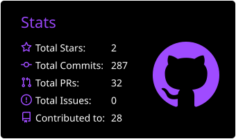
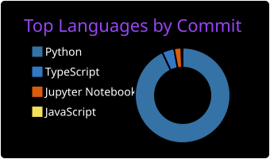
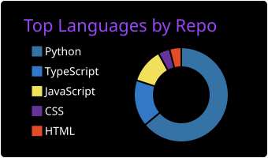
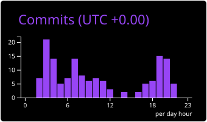

<!-- ═══════════════════════════  HEADER  ═══════════════════════════ -->

 

<!-- ═══════════════════════════  DELIVERY PIPELINE  ═══════════════════════════ -->
## 🚀 Delivery pipeline

  

<b>Atul Raj Gautam</b> · ML engineer in the making · B.Tech CSE (3rd year)

## ⚙️ Operating principles

<pre><code>ROLE         = Data Science / ML · Agentic AI · Full-Stack
BUILDING     = churn-prediction system → MLflow · FastAPI · Docker · CI/CD
LEARNING     = GenAI · agentic workflows · AWS · Kubernetes
GRINDING     = DSA &amp; problem solving
ASK_ME_ABOUT = ML pipelines · LLM agents · MCP · cloud basics · hackathons
SEEKING      = Data Science / ML internships   # status: OPEN</code></pre>

<i>A model that never leaves the notebook never ships. I build for production.</i>

<table>
<tr>
<td width="33%" align="center">
 
<b>Shipping</b> 
Production-grade ML with tracking, APIs, containers & CI
</td>
<td width="33%" align="center">
 
<b>Exploring</b> 
Multi-agent LLM systems, evals & AgentOps
</td>
<td width="33%" align="center">
 
<b>Competing</b> 
Hackathons — idea to deployed demo, fast
</td>
</tr>
</table>

<!-- ═══════════════════════════  UPTIME  ═══════════════════════════ -->
## 📡 Uptime in motion

<!-- ── mission control: terminal telemetry + contribution jet ── -->

<!-- ═══════════════════════════  SIGNALS  ═══════════════════════════ -->
## 📊 Service signals

<b>🔍 &nbsp;cat ./telemetry --verbose</b> (click to expand)

 

<!-- ═══════════════════════════  PROJECTS  ═══════════════════════════ -->
## 🏗️ Infrastructure shipped

<table>
<tr>
<td width="50%" valign="top">

### 🧠 [VEDA_123](https://github.com/jackstealer/VEDA_123)
Multi-agent platform for **M&A due diligence** on Indian startups — six AI agents working the deal.

`multi-agent` `LLM` `due-diligence`

</td>
<td width="50%" valign="top">

### 🛰️ [Jatayuu](https://github.com/jackstealer/Jatayuu)
Real-time simulation & command platform for an **autonomous drone swarm**, with a React dashboard.

`swarm` `simulation` `react`

</td>
</tr>
<tr>
<td width="50%" valign="top">

### 👁️ [visionguard-ai](https://github.com/jackstealer/visionguard-ai)
Multimodal video agent — **YOLOv8** detection + pose estimation + LLM reasoning.

`computer-vision` `yolov8` `agents`

</td>
<td width="50%" valign="top">

### 🌊 [DeepSea-eDNA-AI](https://github.com/jackstealer/DeepSea-eDNA-AI)
Marine biodiversity pipeline for **eDNA** data that reduces reliance on incomplete reference databases.

`bioinformatics` `ml-pipeline`

</td>
</tr>
<tr>
<td width="50%" valign="top">

### ❤️ [heart-disease-analysis](https://github.com/jackstealer/heart-disease-analysis)
Cardiovascular risk assessment with a **6-model ensemble** and LLM-generated insights.

`ensemble` `healthcare` `LLM`

</td>
<td width="50%" valign="top">

### 🌦️ [weather-forecasting-ml](https://github.com/jackstealer/weather-forecasting-ml)
Deep learning + ensemble forecasting, **87%+ reported accuracy**, served via React & Flask.

`deep-learning` `flask` `react`

</td>
</tr>
</table>

<b>📂 &nbsp;ls -la ./all-projects</b> (click to expand)

 

**🤖 AI Agents & GenAI**
| Repo | What it does |
|---|---|
| [agent-reliability-lab](https://github.com/jackstealer/agent-reliability-lab) | CI-style regression tests, LLM-judge evals & tracing for AI agents |
| [venture_capital](https://github.com/jackstealer/venture_capital) | Turns GitHub repositories into investment intelligence |
| [finguide](https://github.com/jackstealer/finguide) | AI-powered personal finance advisor |
| [stock-agent](https://github.com/jackstealer/stock-agent) | Stock analysis agent |

**📊 Machine Learning & Data Science**
| Repo | What it does |
|---|---|
| [ECOMMERCE_CUSTOMER_BEHAVIOR](https://github.com/jackstealer/ECOMMERCE_CUSTOMER_BEHAVIOR) | Customer analytics & churn prediction → being upgraded to production grade |
| [diabetes-ml-api](https://github.com/jackstealer/diabetes-ml-api) | Logistic Regression model served with FastAPI in Docker |
| [netflix_pred](https://github.com/jackstealer/netflix_pred) | Interactive Netflix stock prediction pipeline, five models |
| [google-trends-analyzer](https://github.com/jackstealer/google-trends-analyzer) | CLI + Streamlit dashboard for EDA, forecasting & export |
| [mlops](https://github.com/jackstealer/mlops) | MLOps experiments |
| [ml_project](https://github.com/jackstealer/ml_project) · [my_learning](https://github.com/jackstealer/my_learning) | Daily ML/AI practice & notes |

**🧬 Bioinformatics**
| Repo | What it does |
|---|---|
| [ProteinForge](https://github.com/jackstealer/ProteinForge) | Browser dashboard for AI-driven protein structure prediction |

**🌐 Full-Stack Products**
| Repo | What it does |
|---|---|
| [AgriSmart](https://github.com/jackstealer/AgriSmart) | AI platform connecting farmers and buyers |
| [VisionCart](https://github.com/jackstealer/VisionCart) | Voice-driven, accessible e-commerce for visually impaired users |
| [clear_car](https://github.com/jackstealer/clear_car) | AI insights for used-car buyers in India |
| [uno-arena-live](https://github.com/jackstealer/uno-arena-live) | Real-time multiplayer UNO — Socket.IO, JWT, ELO ranking |
| [SyncChat](https://github.com/jackstealer/SyncChat) | Real-time messaging — React, Node.js, MongoDB |
| [habit-tracker](https://github.com/jackstealer/habit-tracker) | NestJS + Next.js habit tracker |
| [portfolio](https://github.com/jackstealer/portfolio) | Personal site — React, TypeScript, Tailwind |
| [spice-symphony-restaurant](https://github.com/jackstealer/spice-symphony-restaurant) | Responsive restaurant site, dark & gold theme |

<!-- ═══════════════════════════  TOOLKIT  ═══════════════════════════ -->
## 🧰 Platform toolkit

<code>atul@github:~$ toolbox --list</code>

  

<table>
<tr>
<td width="140"><b>Languages</b></td>
<td></td>
</tr>
<tr>
<td><b>AI / ML</b></td>
<td>
 

</td>
</tr>
<tr>
<td><b>Backend & Web</b></td>
<td></td>
</tr>
<tr>
<td><b>MLOps & Cloud</b></td>
<td></td>
</tr>
</table>

<!-- ═══════════════════════════  CONNECT  ═══════════════════════════ -->
## 🔗 Keep it moving

  

&nbsp;&nbsp;
&nbsp;&nbsp;
&nbsp;&nbsp;

⭐ If something here helped you, a star on the repo goes a long way. 
Section visuals by <a href="https://www.gitskins.com/readme-generator">GitSkins</a>

